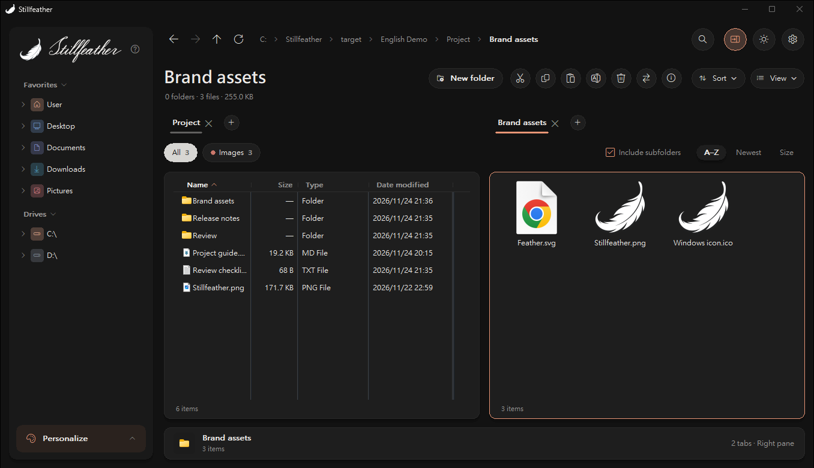
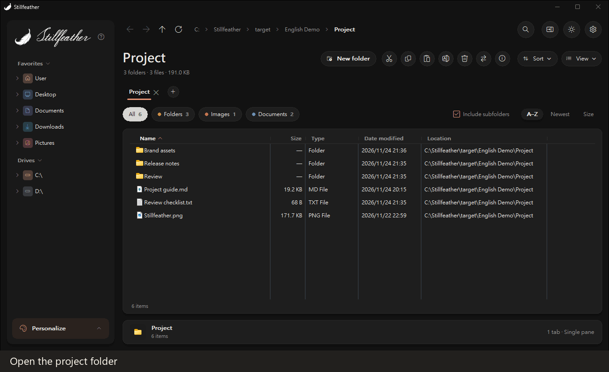
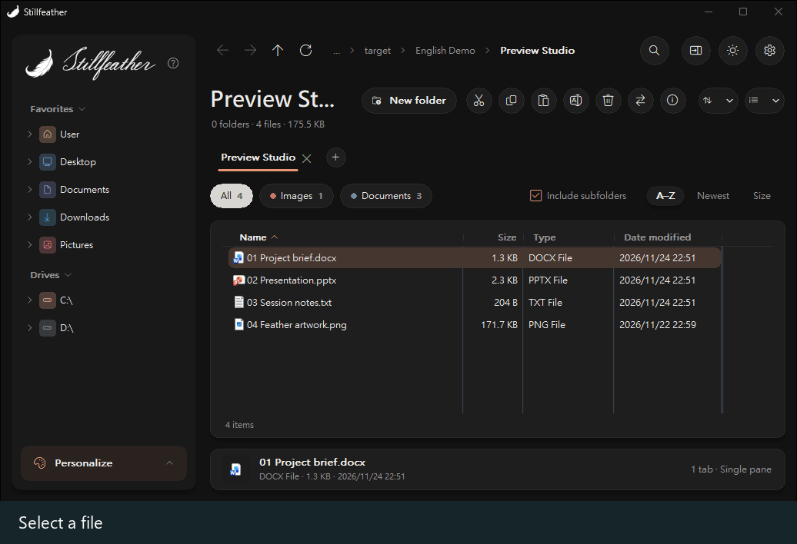

<h1 align="center">Stillfeather</h1>

A lightweight Windows file manager with independent tabs in two panes and quick file previews.

  

Windows 10 / 11 · GPL-3.0 · <a href="README.md">繁體中文</a> · <b>English</b>

**v0.1.6** adds detachable tabs, bookmark groups in Favorites, and customizable shortcuts. Search also supports date, size, and extension filters. This version also adds eight themes, NAS share navigation, and a standalone Help window. [Full 0.1.6 release notes](docs/release-v0.1.6.md#new-features)

## Copy between folders in one window

Press **Ctrl+\\** to split the window. Open the destination on the right, select a file on the left, and click **Copy to other pane**. Both folders stay in view.

## How it compares with Windows File Explorer

| Task | Windows File Explorer | Stillfeather |
| --- | --- | --- |
| Work in two folders | Snap two windows side by side | Split one window into two panes, each with its own tabs |
| Preview a file | Toggle the preview pane with Alt+P | Hover to preview, then hold Space to enlarge |
| Use a shell extension | Some classic commands are under **Show more options** in Windows 11 | Open the classic menu directly, including supported installed extensions |

## Install, switch back, or uninstall

- **Try it alongside File Explorer.** Download `StillfeatherSetup.exe` from the button above. Clear **Set as default file manager** during setup to keep your current defaults. [Installation options](#install)
- **Switch back.** In Stillfeather Settings, turn off the default file manager option. If you enabled replacement Open and Save dialogs, turn that option off too. If Stillfeather cannot start, run `RestoreExplorer.cmd` from the [latest release](https://github.com/Pity0125/Stillfeather/releases/latest).
- **Uninstall.** Open Windows Settings → Apps, select Stillfeather from the installed apps list, and choose **Uninstall**. The uninstaller restores the previous folder-opening settings. [Uninstall details](#uninstall)

## Install

**Requirements**: Windows 10 or Windows 11, 64-bit (x64). No .NET, Office or other runtime needed. On Windows 10 the title bar can only be the system's dark or light color (dark needs version 1809 or later), so it won't exactly match the window; that's a Windows 10 limitation.

1. Download `StillfeatherSetup.exe` from [Releases](https://github.com/Pity0125/Stillfeather/releases/latest). The installer is a single file and needs no network to install.
2. Run it and choose an install location. The default is `%LOCALAPPDATA%\Programs\Stillfeather`, for the current user only, with no administrator rights needed. If you pick a protected location such as `C:\Program Files`, Windows will ask for permission.
3. Choose your options:
   - **Set as default file manager** (checked by default; see [Windows integration](#windows-integration))
   - **Use Stillfeather for other programs' Open and Save dialogs** (unchecked by default; you can also turn it on later in Settings)
   - Create a desktop shortcut
   - Add to the Start menu
4. Click Install (安裝).

If Stillfeather is already installed, the installer upgrades it in place and keeps your settings and pinned locations.

> [!NOTE]
> If Windows shows "Windows protected your PC", that's SmartScreen warning about a program that is new or not code-signed. First make sure you downloaded the file from this project's [Releases](https://github.com/Pity0125/Stillfeather/releases) page, then click "More info" → "Run anyway".
>
> A few antivirus products may also flag new programs that aren't code-signed yet. Every release is checked on [VirusTotal](https://www.virustotal.com) before it's published; if you run into a false positive, please [report it](https://github.com/Pity0125/Stillfeather/issues).

<b>Command-line install (for deployment)</b>

| Option | Description |
|---|---|
| `/S` | Silent install, no UI (sets Stillfeather as the default file manager, same as the UI default) |
| `/D=path` (must be last) or `--dir path` | Install location |
| `--no-default-explorer` | Don't set as the default file manager |
| `--file-picker` | Use Stillfeather for other programs' file dialogs (off by default) |
| `--desktop` | Create a desktop shortcut (not created by default in silent installs) |
| `--no-start-menu` | Don't add to the Start menu |
| `--launch` | Open Stillfeather when the install finishes |

Silent uninstall: `"…\Stillfeather\Uninstall.exe" /S`. See [DEVELOPMENT.md](DEVELOPMENT.md) (in Chinese) for every option.

## Features

### Familiar, but smoother

- **Desktop folders open in tabs.** Set Stillfeather as your default file manager, then double-click different folders on your desktop. Each folder opens in its own tab in the same window.
- **Tabs and dual panes**: the left and right panes each have their own tabs and back/forward history. Ctrl+\\ toggles single/dual pane. Drag files between panes, or use "Copy to other pane". Drag tabs to reorder them, move them to the other pane, or drop them outside the window to open a separate window; Ctrl+Shift+T reopens the tab you just closed. When maximized, drag a tab down into the file list to detach it. Dragging the only tab in a single-pane window moves that window. The source tab closes after the destination loads its folder.
- **Restore your tabs**: next time you open Stillfeather, the main window's tabs in both panes, the selected tabs, and dual-pane mode come back as you left them. The visible tabs load right away; the others load when you switch to them. When you open it with Win+E or by double-clicking a folder, that location opens in a new tab (or switches to it if it's already open). To turn this off, turn off Settings › Browsing › Restore last tabs.
- **Breadcrumb path bar**: click any level to jump there; click the arrow next to a level to list its subfolders and switch to one (arrow keys, Enter and Esc work too). Press Ctrl+E to switch to a text box and type a full path, a relative path (`..`, a subfolder name), or a file path (opens its folder with the file selected).
- **Network locations and NAS**: type `\\computer-name` in the path bar to list the folders it shares. If it needs a user name and password, Windows' own sign-in window appears and the folder opens once you sign in.
- **Per-folder views**: eight views, from extra-large icons to details. Switch one folder to large icons and the others stay as they were.
- **Thumbnails**: the icon views (extra-large, large and medium icons, tiles, and content) show thumbnails for pictures and videos, and for PDFs, PSDs and more when a thumbnail handler is installed, just like File Explorer. Folders that are at least half pictures and videos open in large icons unless you've picked a view for them; to turn that off, untick "相片資料夾用大圖示" (large icons for photo folders) under View › Show. Thumbnails are made in a separate process, so a faulty thumbnail handler can't crash Stillfeather.
- **Filter chips**: show only folders, images, documents, media or archives in one click, with a count for each.
- **Room for your files, and larger text**: the current folder is the last part of the path bar, the filter chips share one row with the common actions, and the bottom is a single status line (the item count, or “N items selected” with their size), so the list takes about 70% of the window. View › Text size (or Settings › Text & language) enlarges file names, columns, the sidebar, tabs, the path bar, filter chips and dialogs up to 150%, and it's remembered next time.
- **Pinned locations**: right-click Favorites to create a bookmark group, then drop folders onto it. Right-click a pinned folder to move it between groups. Right-click a group to rename or remove it. Removing a group keeps its bookmarks in Favorites.
- **Custom shortcuts**: open Settings › Shortcuts, choose a command, enter a key combination and save. Separate multiple combinations with a semicolon (`;`) or leave the field blank to disable the shortcut. A conflict prompt identifies the affected commands. Changes apply when you save.
- **The full right-click menu**: alongside Stillfeather's own commands, you get the entries installed programs add (Open in Terminal, 7-Zip, Git, Send to…), with no "Show more options" step.
- **Open PowerShell window here**: right-click empty space in a folder, a folder, or a folder in the sidebar, no Shift needed. Uses PowerShell 7 when it's installed, otherwise the PowerShell built into Windows.
- **Box selection and empty space**: like File Explorer, the selection highlight stops at the last column. Press on the empty space beside the items or below the last one and drag to draw a box and select several items (hold Ctrl to toggle, or Shift to add to what's already selected); click the empty space to clear the selection. To drag files, drag them from the items as before.
- **Explorer's drag-and-drop rules**: dragging within a drive moves, dragging across drives copies, and Ctrl/Shift/Alt switch to copy, move or create a shortcut. Hover over a tab while dragging to switch to it.
- **Live file list**: when another program adds, deletes, renames or changes files in a folder you're viewing, the list and sidebar update by themselves without pressing F5, and your selection and scroll position stay put. If the folder you're in is renamed, Stillfeather follows it; if it's deleted, it goes up one level.

### Quick preview

Hover over a file and a preview appears beside it. Hold Space to enlarge it in the middle of the window, release to close, and use the arrow keys while holding to move to the next item. If you'd rather not have previews pop up on hover, set **Preview mode** to **Preview with Space** (`空白鍵預覽`) under Settings › Preview, or turn **Quick preview** off entirely (“Quick preview” in the right-click menu still works).

| Type | Preview |
|---|---|
| Images | All common formats; WebP, HEIC and others too if the system has the codec |
| Video | Thumbnail, resolution and length |
| PDF | First page and page count |
| Text and code | Detects UTF-8, UTF-16 or Big5, shows line numbers, syntax highlighting for 20+ languages |
| Word, Excel, PowerPoint, OpenDocument | **No Office needed**: reads paragraphs, headings, lists, slides and tables directly, in a few milliseconds for a typical file |

Office previews only read text and tables; macros and embedded content are never run. Cloud files that aren't downloaded yet won't be downloaded just to preview them.

### Search

Search file names in the current folder (optionally including subfolders) or across the whole PC. Several threads search at once, results appear as they're found, and you can cancel at any time. If the search couldn't finish (too many results, or folders it couldn't read), the results say so.

After the type filters come two buttons, “Date ▾” and “Size ▾”: dates can be Today, Yesterday, This week, This month, This year or a custom range, and sizes can be under 1 MB, 1–100 MB, 100 MB–1 GB, over 1 GB or custom. A chosen condition shows on its button (for example “This week ×”); click × to clear it. Changing a condition filters the current results right away, without searching again. You can also search with filters only and an empty search box: in Downloads, pick “Documents” and “This week”, then press Enter to list this week's documents.

For more control, type conditions in the search box (a full-width colon works too):

| Syntax | Meaning |
|---|---|
| `report 2025` | Names containing all of these words, in any order |
| `"annual report"` | The exact phrase |
| `-draft` | Exclude names containing the word |
| `*.pdf` | Wildcards match the whole name: `*` is any text, `?` is one character |
| `ext:pdf;docx` | By extension |
| `size:>100mb`, `size:1mb..10mb` | By size (also `<`, `>=`, `<=`; `size:empty` for empty files; folders are hidden) |
| `dm:today`, `dm:7d`, `dm:2026-11-01..2026-11-20` | By date modified (`yesterday`, `thisweek`, `thismonth`, `thisyear`, `2w`; `datemodified:` also works) |
| `folder:`, `file:` | Folders only / files only |

Results are sorted by relevance: an exact name (ignoring the extension) first, then names that start with the word, have it at the start of a word, or contain it; within each group, shallower and newer items come first. Click a column heading to sort by it; “Sort › Relevance” switches back. The same table is on the “Search” page of Help (F1 or the ? button).

### Mistakes are easy to undo

Ctrl+Z reverses your last 30 renames, moves and deletes. Delete sends files to the Recycle Bin first, and undo moves them back to where they were. If a file with the same name is already there, it won't be overwritten. Shift+Delete deletes permanently: it asks first and can't be undone. Whether moving to the Recycle Bin asks first follows Windows' own "Display delete confirmation dialog" setting in the Recycle Bin's Properties.

### Quiet and soft

- By default, light mode uses an off-white base and dark mode a near-black charcoal, with a soft terracotta accent, large rounded cards and pill-shaped buttons. Seven more tuned themes (Sage, Harbor, Lavender, Rose, Amber, Teal, Graphite) each come in light and dark and follow Windows' light/dark mode. For fully custom colors, use “Custom colors (advanced)” under Settings › Theme & colors.
- Confirmations and errors use Stillfeather's own dialogs, with no Windows "ding".
- Changing folders, switching tabs, selecting and hovering all fade smoothly. If you turn off "Animation effects" in Windows, everything switches instantly.
- High-DPI aware, and it readjusts when you move between monitors with different scaling.
- The interface is in English or Traditional Chinese. It follows your Windows display language (Chinese gets Traditional Chinese, everything else English), and you can pick one under **Language** in Settings; it applies after Stillfeather restarts, and Stillfeather offers to restart right away with your tabs kept.

## Windows integration

These settings only affect the current user, not other people on the same PC, and you can turn any of them off at any time in Stillfeather's Settings (F12).

### Default file manager

**Set as default file manager** (`設為預設檔案總管`): **Win+E** and double-clicking folders or drives on the desktop or in other programs open Stillfeather. If Stillfeather is already open, they open a new tab. "Show in folder" in a browser's downloads list and "Open containing folder" in other programs also open Stillfeather, with the file selected.

- Uncheck it in Settings and File Explorer is back immediately.
- Windows' own "Open" stays in the right-click menu.
- If you turn it off, Stillfeather remembers and won't turn it back on. If you later switch to a different file manager, Stillfeather won't take over again.

### Win+E on newer Windows 11

Windows 11 updates rolling out since October 2026 make Win+E open File Explorer directly, ignoring the default file manager setting (double-clicking folders isn't affected). So Settings also has **Intercept Win+E and open Stillfeather** (`攔截 Win+E 按鍵，改開 Stillfeather`), on by default:

- While it's on, Stillfeather runs a small windowless background helper (started at sign-in) that catches Win+E and opens Stillfeather instead. It only checks whether E is pressed together with the Windows key and lets every other key through; it never records or sends any keystrokes.
- If you don't want a background helper, turn it off and Win+E goes back to Windows' behavior.
- When a window running as administrator is in front, Win+E still opens File Explorer.
- Some antivirus software may treat the key interception as suspicious.

### Choosing files to open, upload or save

**Use Stillfeather for other programs' Open and Save dialogs** (`其他程式開啟或儲存檔案時也用 Stillfeather`) is off by default; check it in Settings to turn it on. Once it's on, uploading a file on a web page, and other programs' Open, Save As and Select Folder dialogs, show a compact Stillfeather picker:

- It keeps only what you need to pick a file: back/forward/up, the path bar, refresh, search, new folder, sort and view, the folder tree, the file list, and the file name box, file type and OK/Cancel at the bottom. Hover preview, drag and drop and the right-click menu all still work.
- Double-click a folder to open it, and double-click a file (or select it and click Open) to hand it to the program. Programs that allow multiple files let you pick several. The file name box accepts a name, a path, or a filter like `*.png`.
- When saving, the name (without its extension) is already selected in the file name box, so you can just type over it. The extension is added for you and follows the file type you pick, and you're asked before an existing file is replaced. Put the name in quotes (`"README"`) or end it with a dot (`README.`) to save it without an extension.
- Each program remembers the last folder you used.
- **Use Windows dialog** (`使用 Windows 視窗`) in the top-right corner switches back to the standard Windows dialog at any time. Programs running as administrator, 32-bit programs, and cases where Stillfeather can't be found always get the Windows dialog, so you can always pick a file.
- When a program adds its own options to the dialog (an encoding drop-down, "Open as read-only" and so on), or asks for file details such as authors and tags when saving, it gets the Windows dialog as usual, so those options don't disappear.
- This feature loads a Stillfeather component into other programs. If a program misbehaves when opening files, uncheck it to switch back, and please report which program it was.
- Programs that are already open may need to be restarted before the change applies.

### If folders won't open

- If Stillfeather fails to start three times within a minute, it switches back to File Explorer by itself (default file manager, Win+E and file dialogs all go back to Windows), opens the location you asked for in File Explorer, and tells you how to report it. Once the problem is fixed, check the options again in Settings.
- If the Stillfeather that's already open stops responding (for example, stuck in another program's right-click menu extension), double-clicking a folder or pressing Win+E opens the location in File Explorer instead.
- If Stillfeather won't open at all, or its install folder was deleted without uninstalling: download `RestoreExplorer.cmd` from [Releases](https://github.com/Pity0125/Stillfeather/releases/latest) and double-click it. It only changes the current user's settings: it closes Stillfeather, points folders and Win+E back to File Explorer and restores the standard Windows file dialogs. Your files are never touched.

## Keyboard shortcuts

The table lists the defaults. Press `F1` or click `?` to see your current bindings in a separate Help window. During search, `F1` opens the syntax guide. `Ctrl+C` copies the page and `Esc` closes Help.

| Keys | Action |
|---|---|
| Ctrl+T, Ctrl+N | New tab |
| Ctrl+W, middle-click a tab | Close tab |
| Ctrl+Tab, Ctrl+Shift+Tab, Ctrl+PgUp / PgDn | Switch tabs |
| Ctrl+1–8, Ctrl+9 | Go to tab 1–8, or the last tab |
| Ctrl+Shift+T | Reopen the tab you just closed |
| Ctrl+Shift+PgUp / PgDn, drag a tab | Reorder tabs |
| Ctrl+\\ | Toggle single/dual pane |
| Ctrl+E, Alt+D | Edit path |
| Ctrl+F | Search |
| Alt+← / → / ↑, Backspace | Back / forward / up |
| F5 | Refresh |
| F2 | Rename |
| Delete, Ctrl+D | Delete to Recycle Bin |
| Shift+Delete | Delete permanently (asks first) |
| Ctrl+C / X / V | Copy / cut / paste |
| Ctrl+Z | Undo |
| Ctrl+Shift+C | Copy path |
| Ctrl+Shift+N | New folder |
| Alt+Enter | Properties |
| Hold Space | Enlarged preview, release to close (arrow keys change items while held) |
| Ctrl+Shift+1–8 | Switch view (remembered for the current folder) |
| F12, Ctrl+, | Settings |
| F1 | Help (shortcuts, search syntax, quick preview, drag and drop, undo) |
| Type in the list or sidebar | Jump to the first item whose name starts with what you typed |

## Updates

Stillfeather checks for new versions in the background (at most once every 20 hours). When there is one, it shows the new version, download size and release notes, and you can choose Update, Skip this version, or Later.

- The release info (`update.json`) is only accepted if it carries Stillfeather's signature. The signing key is kept offline, not on GitHub, so even if the GitHub account were compromised, nobody could publish a fake update that Stillfeather would install.
- A downloaded installer only runs if its size and SHA-256 exactly match the published release. If your current version is code-signed, the new one must have a valid signature too.
- Updating keeps your shortcuts and default file manager setting, and reopens Stillfeather when done.
- To stop the reminders, uncheck **Remind me about updates** (`啟動時提醒更新`) under Settings › About & updates. **Check for updates** (`檢查更新`) above it checks manually at any time. When it finds a new version, the button becomes **Update now** (`立即更新`); click it to start.

## Uninstall

In Windows, go to **Settings › Apps › Installed apps**, find Stillfeather and click **Uninstall**. It will:

- Restore File Explorer as the default file manager (or whatever you had before), restore the standard Windows file dialogs, and stop the Win+E helper
- Remove the program and shortcuts, along with Stillfeather's settings, logs and temporary files

**Your own files are never touched.**

If the install folder has already been deleted and you can't uninstall from Settings, use `RestoreExplorer.cmd` from [If folders won't open](#if-folders-wont-open).

## Privacy

- Stillfeather doesn't collect or upload any usage data. Its only network connection is the update check against GitHub, which you can turn off in Settings.
- Settings and logs are stored on your PC in `%LOCALAPPDATA%\Stillfeather`.

## Reporting a bug

Please open an [issue](https://github.com/Pity0125/Stillfeather/issues). Describe what happened and how to reproduce it, and include your Stillfeather version (shown in **Settings › Apps › Installed apps**).

If Stillfeather closes unexpectedly, `trace.log` and `crash.log` in `%LOCALAPPDATA%\Stillfeather\logs` help find the cause (after an automatic switch back to File Explorer, they're `trace-before-rescue.log` and `crash-before-rescue.log`). Logs may contain folder paths, so look them over before attaching them.

## Building from source

Stillfeather has no third-party dependencies. On Windows:

- Double-click `Launch.cmd` to build and run it (if Rust isn't installed, it offers to install it for you).
- Double-click `BuildSetup.cmd` to produce the installer `dist\StillfeatherSetup.exe`.
- Run `.\test.ps1` in PowerShell to run all the tests.

For build details, tests, project structure and how to publish a release, see [DEVELOPMENT.md](DEVELOPMENT.md) (in Chinese). Changes in each version are listed in [CHANGELOG.md](CHANGELOG.md) (in Chinese).

## License

Stillfeather is licensed under the [GNU General Public License v3.0](LICENSE) or later: you're free to use, modify and share it, and if you distribute a modified version you must publish its source under the same license.
