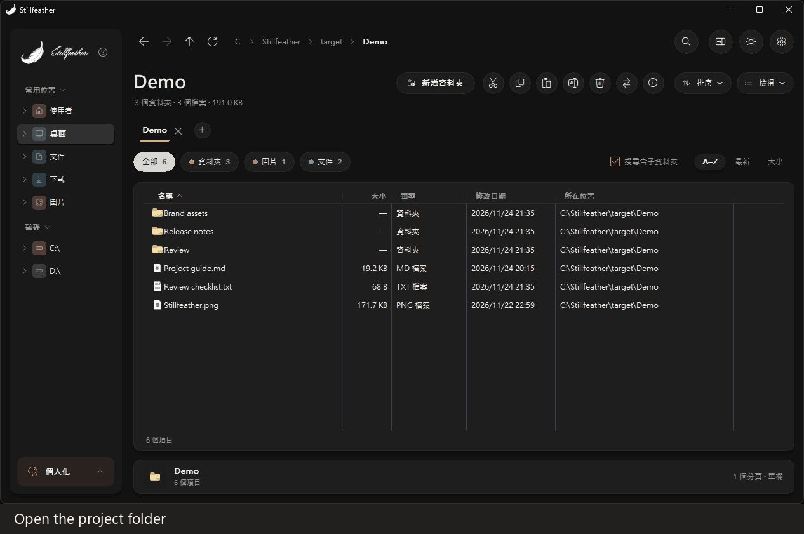

  

<h1 align="center">Stillfeather</h1>

  A quiet, lightweight file manager for Windows

  
  
  
  

  <a href="https://github.com/Pity0125/Stillfeather/releases/latest"><b>Download</b></a> ·
  <a href="#install">Install</a> ·
  <a href="#keyboard-shortcuts">Shortcuts</a> ·
  <a href="https://github.com/Pity0125/Stillfeather/issues">Report a bug</a>

  <a href="README.md">繁體中文</a> · <b>English</b>

<!-- Screenshots: save them as docs/screenshot-light.png and docs/screenshot-dark.png (about 1600×1000),
     and a short demo GIF as docs/demo.gif, then remove this comment wrapper.

-->

---

Stillfeather is a file manager built to replace Windows File Explorer. Everything you already know still works the same way: the same shortcuts, the same drag-and-drop rules, the same right-click menu entries. On top of that you get tabs, dual panes, quick preview and Ctrl+Z undo, in a soft off-white and charcoal interface.

It's written in Rust on native Win32, with no web engine, no .NET and no third-party packages. It stops redrawing once an animation ends, so it uses no CPU while idle.

> [!NOTE]
> The interface is currently in **Traditional Chinese** only. Where this page mentions a setting, the Chinese label is shown next to it so you can find it.

## Highlights

- **Tabs and dual panes**: each pane has its own tabs, and you can drag files straight between them. Your tabs come back the next time you open it.
- **Photo thumbnails**: photo folders open in large icons with thumbnails, and videos and PDFs get them too.
- **Quick preview**: images, video, PDF, code, plus Word, Excel and PowerPoint, with no Office required.
- **Ctrl+Z undo**: your last 30 renames, moves and deletes can be reversed.
- **Whole-PC search**: multi-threaded, with results appearing as they're found.
- **Takes over from Windows**: Win+E, double-clicking folders, and file pickers for web uploads can all use Stillfeather.
- **Quiet**: its own dialogs, no system "ding", subtle animations.

## Install

**Requirements**: Windows 10 or Windows 11, 64-bit (x64). No .NET, Office or other runtime needed.

1. Download `StillfeatherSetup.exe` from [Releases](https://github.com/Pity0125/Stillfeather/releases/latest). The installer is a single file and needs no network to install.
2. Run it and choose an install location. The default is `%LOCALAPPDATA%\Programs\Stillfeather`, for the current user only, with no administrator rights needed. If you pick a protected location such as `C:\Program Files`, Windows will ask for permission.
3. Choose your options:
   - **Set as default file manager** (checked by default; see [Windows integration](#windows-integration))
   - **Use Stillfeather for other programs' Open and Save dialogs** (unchecked by default; you can also turn it on later in Settings)
   - Create a desktop shortcut
   - Add to the Start menu
4. Click Install (安裝).

If Stillfeather is already installed, the installer upgrades it in place and keeps your settings and pinned locations.

> [!NOTE]
> If Windows shows "Windows protected your PC", that's SmartScreen warning about a program that is new or not code-signed. First make sure you downloaded the file from this project's [Releases](https://github.com/Pity0125/Stillfeather/releases) page, then click "More info" → "Run anyway".
>
> A few antivirus products may also flag new programs that aren't code-signed yet. Every release is checked on [VirusTotal](https://www.virustotal.com) before it's published; if you run into a false positive, please [report it](https://github.com/Pity0125/Stillfeather/issues).

<b>Command-line install (for deployment)</b>

| Option | Description |
|---|---|
| `/S` | Silent install, no UI (sets Stillfeather as the default file manager, same as the UI default) |
| `/D=path` (must be last) or `--dir path` | Install location |
| `--no-default-explorer` | Don't set as the default file manager |
| `--file-picker` | Use Stillfeather for other programs' file dialogs (off by default) |
| `--desktop` | Create a desktop shortcut (not created by default in silent installs) |
| `--no-start-menu` | Don't add to the Start menu |
| `--launch` | Open Stillfeather when the install finishes |

Silent uninstall: `"…\Stillfeather\Uninstall.exe" /S`. See [DEVELOPMENT.md](DEVELOPMENT.md) (in Chinese) for every option.

## Features

### Familiar, but smoother

- **Tabs and dual panes**: the left and right panes each have their own tabs and back/forward history. Ctrl+Shift+D toggles single/dual pane. Drag files between panes, or use "Copy to other pane".
- **Restore your tabs**: next time you open Stillfeather, both panes' tabs, the selected tabs, and dual-pane mode come back as you left them. The visible tabs load right away; the others load when you switch to them. When you open it with Win+E or by double-clicking a folder, that location opens in a new tab (or switches to it if it's already open). To turn this off, untick "還原上次的分頁" (restore tabs) in Settings.
- **Breadcrumb path bar**: click any level to jump there. Press Ctrl+L to switch to a text box and type a full path, a relative path (`..`, a subfolder name), or a file path (opens its folder with the file selected).
- **Per-folder views**: eight views, from extra-large icons to details. Switch one folder to large icons and the others stay as they were.
- **Thumbnails**: the icon views (extra-large, large and medium icons, tiles, and content) show thumbnails for pictures and videos, and for PDFs, PSDs and more when a thumbnail handler is installed, just like File Explorer. Folders that are at least half pictures and videos open in large icons unless you've picked a view for them; to turn that off, untick "相片資料夾用大圖示" (large icons for photo folders) under View › Show. Thumbnails are made in a separate process, so a faulty thumbnail handler can't crash Stillfeather.
- **Filter chips**: show only folders, images, documents, media or archives in one click, with a count for each.
- **Pinned locations**: drag a folder onto the sidebar to pin it, or pin and unpin from the right-click menu.
- **The full right-click menu**: alongside Stillfeather's own commands, you get the entries installed programs add (Open in Terminal, 7-Zip, Git, Send to…), with no "Show more options" step.
- **Open PowerShell window here**: right-click empty space in a folder, a folder, or a folder in the sidebar, no Shift needed. Uses PowerShell 7 when it's installed, otherwise the PowerShell built into Windows.
- **Explorer's drag-and-drop rules**: dragging within a drive moves, dragging across drives copies, and Ctrl/Shift/Alt switch to copy, move or create a shortcut. Hover over a tab while dragging to switch to it.
- **Live file list**: when another program adds, deletes, renames or changes files in a folder you're viewing, the list and sidebar update by themselves without pressing F5, and your selection and scroll position stay put. If the folder you're in is renamed, Stillfeather follows it; if it's deleted, it goes up one level.

### Quick preview

Hover over a file and a preview appears beside it. Hold Space to enlarge it in the middle of the window, release to close, and use the arrow keys while holding to move to the next item. If you'd rather not have previews pop up on hover, turn on **Preview with Space** (`按空白鍵預覽`) in Settings.

| Type | Preview |
|---|---|
| Images | All common formats; WebP, HEIC and others too if the system has the codec |
| Video | Thumbnail, resolution and length |
| PDF | First page and page count |
| Text and code | Detects UTF-8, UTF-16 or Big5, shows line numbers, syntax highlighting for 20+ languages |
| Word, Excel, PowerPoint, OpenDocument | **No Office needed**: reads paragraphs, headings, lists, slides and tables directly, in a few milliseconds for a typical file |

Office previews only read text and tables; macros and embedded content are never run. Cloud files that aren't downloaded yet won't be downloaded just to preview them.

### Search

Search file names in the current folder (optionally including subfolders) or across the whole PC. Several threads search at once, results appear as they're found, and you can cancel at any time. If the search couldn't finish (too many results, or folders it couldn't read), the results say so.

### Mistakes are easy to undo

Ctrl+Z reverses your last 30 renames, moves and deletes. Deleted files always go to the Recycle Bin first, and undo moves them back to where they were. If a file with the same name is already there, it won't be overwritten.

### Quiet and soft

- Light mode uses an off-white base and dark mode a near-black charcoal, with a soft terracotta accent, large rounded cards and pill-shaped buttons. It follows Windows' light/dark mode, and you can customize the accent and background colors.
- Confirmations and errors use Stillfeather's own dialogs, with no Windows "ding".
- Changing folders, switching tabs, selecting and hovering all fade smoothly. If you turn off "Animation effects" in Windows, everything switches instantly.
- High-DPI aware, and it readjusts when you move between monitors with different scaling.
- The interface is in English or Traditional Chinese. It follows your Windows display language (Chinese gets Traditional Chinese, everything else English), and you can pick one under **Language** in Settings; it applies after Stillfeather restarts, and Stillfeather offers to restart right away with your tabs kept.

## Windows integration

These settings only affect the current user, not other people on the same PC, and you can turn any of them off at any time in Stillfeather's Settings (F12).

### Default file manager

**Set as default file manager** (`設為預設檔案總管`): **Win+E** and double-clicking folders or drives on the desktop or in other programs open Stillfeather. If Stillfeather is already open, they open a new tab. "Show in folder" in a browser's downloads list and "Open containing folder" in other programs also open Stillfeather, with the file selected.

- Uncheck it in Settings and File Explorer is back immediately.
- Windows' own "Open" stays in the right-click menu.
- If you turn it off, Stillfeather remembers and won't turn it back on. If you later switch to a different file manager, Stillfeather won't take over again.

### Win+E on newer Windows 11

Windows 11 updates rolling out since October 2026 make Win+E open File Explorer directly, ignoring the default file manager setting (double-clicking folders isn't affected). So Settings also has **Intercept Win+E and open Stillfeather** (`攔截 Win+E 按鍵，改開 Stillfeather`), on by default:

- While it's on, Stillfeather runs a small windowless background helper (started at sign-in) that catches Win+E and opens Stillfeather instead. It only checks whether E is pressed together with the Windows key and lets every other key through; it never records or sends any keystrokes.
- If you don't want a background helper, turn it off and Win+E goes back to Windows' behavior.
- When a window running as administrator is in front, Win+E still opens File Explorer.
- Some antivirus software may treat the key interception as suspicious.

### Choosing files to open, upload or save

**Use Stillfeather for other programs' Open and Save dialogs** (`其他程式開啟或儲存檔案時也用 Stillfeather`) is off by default; check it in Settings to turn it on. Once it's on, uploading a file on a web page, and other programs' Open, Save As and Select Folder dialogs, show a compact Stillfeather picker:

- It keeps only what you need to pick a file: back/forward/up, the path bar, refresh, search, new folder, sort and view, the folder tree, the file list, and the file name box, file type and OK/Cancel at the bottom. Hover preview, drag and drop and the right-click menu all still work.
- Double-click a folder to open it, and double-click a file (or select it and click Open) to hand it to the program. Programs that allow multiple files let you pick several. The file name box accepts a name, a path, or a filter like `*.png`.
- When saving, the name (without its extension) is already selected in the file name box, so you can just type over it. The extension is added for you and follows the file type you pick, and you're asked before an existing file is replaced. Put the name in quotes (`"README"`) or end it with a dot (`README.`) to save it without an extension.
- Each program remembers the last folder you used.
- **Use Windows dialog** (`使用 Windows 視窗`) in the top-right corner switches back to the standard Windows dialog at any time. Programs running as administrator, 32-bit programs, and cases where Stillfeather can't be found always get the Windows dialog, so you can always pick a file.
- When a program adds its own options to the dialog (an encoding drop-down, "Open as read-only" and so on), or asks for file details such as authors and tags when saving, it gets the Windows dialog as usual, so those options don't disappear.
- This feature loads a Stillfeather component into other programs. If a program misbehaves when opening files, uncheck it to switch back, and please report which program it was.
- Programs that are already open may need to be restarted before the change applies.

### If folders won't open

- If Stillfeather fails to start three times within a minute, it switches back to File Explorer by itself (default file manager, Win+E and file dialogs all go back to Windows), opens the location you asked for in File Explorer, and tells you how to report it. Once the problem is fixed, check the options again in Settings.
- If the Stillfeather that's already open stops responding (for example, stuck in another program's right-click menu extension), double-clicking a folder or pressing Win+E opens the location in File Explorer instead.
- If Stillfeather won't open at all, or its install folder was deleted without uninstalling: download `RestoreExplorer.cmd` from [Releases](https://github.com/Pity0125/Stillfeather/releases/latest) and double-click it. It only changes the current user's settings: it closes Stillfeather, points folders and Win+E back to File Explorer and restores the standard Windows file dialogs. Your files are never touched.

## Keyboard shortcuts

| Keys | Action |
|---|---|
| Ctrl+T, Ctrl+N | New tab |
| Ctrl+W, middle-click a tab | Close tab |
| Ctrl+Tab, Ctrl+Shift+Tab | Switch tabs |
| Ctrl+Shift+D | Toggle single/dual pane |
| Ctrl+L, Alt+D | Edit path |
| Ctrl+F | Search |
| Alt+← / → / ↑, Backspace | Back / forward / up |
| F5 | Refresh |
| F2 | Rename |
| Delete, Ctrl+D | Delete to Recycle Bin |
| Ctrl+C / X / V | Copy / cut / paste |
| Ctrl+Z | Undo |
| Ctrl+Shift+C | Copy path |
| Alt+Enter | Properties |
| Hold Space | Enlarged preview, release to close (arrow keys change items while held) |
| Ctrl+Shift+1–8 | Switch view (remembered for the current folder) |
| F12, Ctrl+, | Settings |
| Type in the list or sidebar | Jump to the first item whose name starts with what you typed |

## Updates

Stillfeather checks for new versions in the background (at most once every 20 hours). When there is one, it shows the new version, download size and release notes, and you can choose Update, Skip this version, or Later.

- The release info (`update.json`) is only accepted if it carries Stillfeather's signature. The signing key is kept offline, not on GitHub, so even if the GitHub account were compromised, nobody could publish a fake update that Stillfeather would install.
- A downloaded installer only runs if its size and SHA-256 exactly match the published release. If your current version is code-signed, the new one must have a valid signature too.
- Updating keeps your shortcuts and default file manager setting, and reopens Stillfeather when done.
- To stop the reminders, check **No update reminders** (`不要啟用更新提醒`) in Settings. **Check for updates** (`檢查更新`) next to it checks manually at any time. When it finds a new version, the button becomes **Update now** (`立即更新`); click it to start.

## Uninstall

In Windows, go to **Settings › Apps › Installed apps**, find Stillfeather and click **Uninstall**. It will:

- Restore File Explorer as the default file manager (or whatever you had before), restore the standard Windows file dialogs, and stop the Win+E helper
- Remove the program and shortcuts, along with Stillfeather's settings, logs and temporary files

**Your own files are never touched.**

If the install folder has already been deleted and you can't uninstall from Settings, use `RestoreExplorer.cmd` from [If folders won't open](#if-folders-wont-open).

## Privacy

- Stillfeather doesn't collect or upload any usage data. Its only network connection is the update check against GitHub, which you can turn off in Settings.
- Settings and logs are stored on your PC in `%LOCALAPPDATA%\Stillfeather`.

## Reporting a bug

Please open an [issue](https://github.com/Pity0125/Stillfeather/issues). Describe what happened and how to reproduce it, and include your Stillfeather version (shown in **Settings › Apps › Installed apps**).

If Stillfeather closes unexpectedly, `trace.log` and `crash.log` in `%LOCALAPPDATA%\Stillfeather\logs` help find the cause (after an automatic switch back to File Explorer, they're `trace-before-rescue.log` and `crash-before-rescue.log`). Logs may contain folder paths, so look them over before attaching them.

## Building from source

Stillfeather has no third-party dependencies. On Windows:

- Double-click `Launch.cmd` to build and run it (if Rust isn't installed, it offers to install it for you).
- Double-click `BuildSetup.cmd` to produce the installer `dist\StillfeatherSetup.exe`.
- Run `.\test.ps1` in PowerShell to run all the tests.

For build details, tests, project structure and how to publish a release, see [DEVELOPMENT.md](DEVELOPMENT.md) (in Chinese). Changes in each version are listed in [CHANGELOG.md](CHANGELOG.md) (in Chinese).

## License

Stillfeather is licensed under the [GNU General Public License v3.0](LICENSE) or later: you're free to use, modify and share it, and if you distribute a modified version you must publish its source under the same license.
