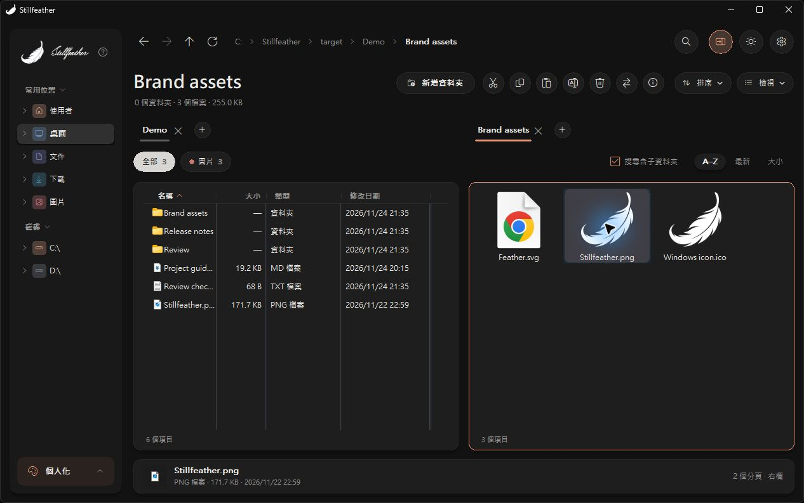
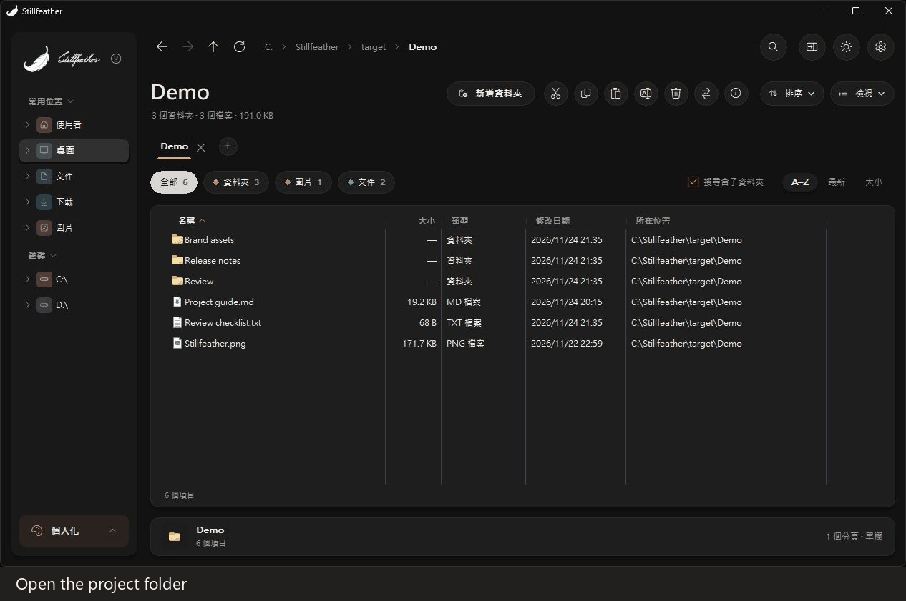
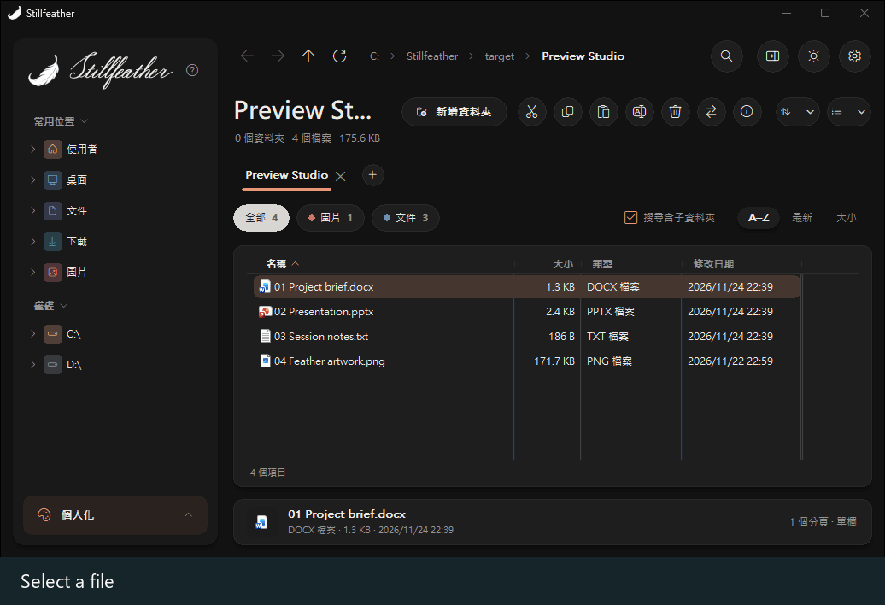

<h1 align="center">Stillfeather</h1>

免費、開源的 Windows 檔案管理器。左右兩欄各有分頁，搬檔案、看預覽都能在同一個視窗完成。

  

Windows 10 / 11 · GPL-3.0 · <b>繁體中文</b> · <a href="README.en.md">English</a>

**v0.1.7** 加入側欄自訂標籤，中鍵點資料夾就在新分頁開啟，路徑列也能像 Win+R 一樣執行程式。搜尋框按 ↓ 可以叫出最近搜尋。本版另改版了快速鍵設定，拖曳框選也更跟手。[完整 0.1.7 發行說明](docs/release-v0.1.7.md#新增功能)

## 在同一個視窗整理兩個資料夾

按 **Ctrl+\\** 開啟雙欄，在右欄打開目的地，再從左欄選取檔案，按工具列的「複製到另一欄」。複製完成後，兩邊的檔案都看得到。

## 與 Windows 檔案總管比較

| 日常操作 | Windows 檔案總管 | Stillfeather |
| --- | --- | --- |
| 同時整理兩個資料夾 | 將兩個視窗並排 | 一個視窗分成兩欄，每欄各有自己的分頁 |
| 看一眼檔案內容 | 按 Alt+P 開關預覽窗格 | 游標停在檔案上即可預覽，按住空白鍵放大 |
| 使用右鍵擴充功能 | Windows 11 的部分傳統指令收在「顯示其他選項」 | 直接開啟傳統選單，列出已安裝且支援的擴充指令 |

## 安裝、切回原版與解除安裝

- **先試用。** 點上方 Download，到最新版下載 `StillfeatherSetup.exe`。若想保留目前開啟資料夾的方式，安裝時取消勾選「設為預設檔案總管」。[完整安裝選項](#安裝)
- **切回 Windows 檔案總管。** 在 Stillfeather「設定」取消勾選「設為預設檔案總管」。若也開啟了「開啟／另存新檔」視窗接管，一併關閉該選項。若程式已無法啟動，可從[最新版發行頁](https://github.com/Pity0125/Stillfeather/releases/latest)下載並執行 `RestoreExplorer.cmd`。
- **解除安裝。** 到 Windows「設定 → 應用程式」，從已安裝的清單找到 Stillfeather，選「解除安裝」。解除安裝程式會還原先前開啟資料夾的設定。[解除安裝細節](#解除安裝)

## 安裝

**系統需求**：Windows 10 或 Windows 11，64 位元（x64）。不需要 .NET、Office 或其他執行環境。Windows 10 的標題列只有系統的深色或淺色（1809 以後才有深色），不會和視窗內容同色；這是 Windows 10 的限制。

1. 到 [Releases](https://github.com/Pity0125/Stillfeather/releases/latest) 下載 `StillfeatherSetup.exe`。安裝程式只有這一個檔案，安裝時不需要網路。
2. 執行後選擇安裝位置，預設是 `%LOCALAPPDATA%\Programs\Stillfeather`，只裝給目前使用者，不需要系統管理員權限。選到 `C:\Program Files` 這類需要權限的位置時，Windows 會詢問是否允許。
3. 選擇選項：
   - **設為預設檔案總管**（預設勾選，見[和 Windows 整合](#和-windows-整合)）
   - **其他程式開啟或儲存檔案時也用 Stillfeather**（預設不勾；想用的話勾選，之後也可以在設定開啟）
   - 建立桌面捷徑
   - 加入開始功能表
4. 按「安裝」。

已經裝過時會直接覆蓋升級，設定與常用位置都會保留。

> [!NOTE]
> 如果 Windows 顯示「Windows 已保護您的電腦」，這是 SmartScreen 對下載量還少或沒有數位簽章的程式的提醒。請先確認檔案是從這個專案的 [Releases](https://github.com/Pity0125/Stillfeather/releases) 頁面下載的，再按「其他資訊」→「仍要執行」。
>
> 少數防毒軟體也可能把還沒有數位簽章的新程式誤判為可疑。每個版本發佈前都會用 [VirusTotal](https://www.virustotal.com) 檢查；遇到誤判歡迎[回報](https://github.com/Pity0125/Stillfeather/issues)。

<b>命令列安裝（大量部署用）</b>

| 參數 | 說明 |
|---|---|
| `/S` | 靜默安裝，不顯示畫面（和畫面上的預設一樣會設為預設檔案總管） |
| `/D=路徑`（放在最後）或 `--dir 路徑` | 安裝位置 |
| `--no-default-explorer` | 不設為預設檔案總管 |
| `--file-picker` | 其他程式開啟或儲存檔案時也用 Stillfeather（預設不使用） |
| `--desktop` | 建立桌面捷徑（靜默安裝預設不建立） |
| `--no-start-menu` | 不加入開始功能表 |
| `--launch` | 安裝完成後開啟 Stillfeather |

靜默解除安裝：`"…\Stillfeather\Uninstall.exe" /S`。完整參數見 [DEVELOPMENT.md](DEVELOPMENT.md)。

## 功能

### 熟悉，但更順手

- **桌面資料夾開在同一個視窗**：將 Stillfeather 設為預設檔案總管後，在桌面依序雙擊不同資料夾，每個資料夾都會在同一個 Stillfeather 視窗中以獨立分頁開啟。
- **分頁與雙欄**：左右兩欄各自有分頁和上一頁／下一頁紀錄。Ctrl+\\ 切換單欄／雙欄，檔案可以直接在兩欄之間拖放，或用「複製到另一欄」。分頁可以拖曳調整順序、移到另一欄，或拖出視窗邊界獨立開窗；Ctrl+Shift+T 重新開啟剛關掉的分頁。最大化時，把分頁往下拖進清單即可獨立開窗；單欄只剩一個分頁時會移動視窗。新視窗成功載入後，原分頁才會關閉。
- **還原上次的分頁**：下次開啟時，主視窗左右欄的分頁、選取的分頁與雙欄都照上次關閉時的樣子開回來；顯示中的分頁馬上讀取，其他的切過去時才讀。從 Win+E 或雙擊資料夾開啟時，要開的位置會開在新分頁（已經開著就切過去）。不想要的話在「設定」取消勾選「還原上次的分頁」。
- **麵包屑路徑列**：點任何一層直接前往；點每一層右邊的箭頭，列出那一層的子資料夾，選一個就切換過去（方向鍵、Enter、Esc 也能操作）。按 Ctrl+E 改成輸入框，可以輸入完整路徑、相對路徑（`..`、子資料夾名稱），或檔案路徑（會開啟所在資料夾並選取那個檔案）。也可以像 Win+R 一樣執行程式、捷徑與指令（`cmd` 會在目前的資料夾開命令提示字元），或輸入 `shell:startup` 這類位置。
- **網路位置與 NAS**：在路徑列輸入 `\\電腦名稱` 就列出它分享的資料夾。需要帳號密碼時跳出 Windows 的登入視窗，登入後自動開啟。
- **每個資料夾記住自己的檢視**：從超大圖示到內容共八種檢視。把某個資料夾換成大圖示，其他資料夾不受影響。
- **縮圖**：圖示類的檢視（超大、大、中圖示、並排與內容）顯示圖片、影片的縮圖，裝了對應的縮圖處理程式時 PDF、PSD 等也有，和檔案總管一樣。圖片與影片佔一半以上的資料夾，沒改過檢視時直接用大圖示；不想要的話在「檢視 › 顯示」取消「相片資料夾用大圖示」。縮圖在另一個程序產生，某個檔案的縮圖程式出錯也不會讓 Stillfeather 當掉。
- **篩選籤**：一鍵只看資料夾、圖片、文件、影音或壓縮檔，每一類都標示數量。
- **清單佔大部分視窗、文字可以調大**：目前資料夾顯示在路徑列最後一段，篩選籤和常用操作同一列，底部只有一行狀態列（項目數，或「已選取 N 個項目」與大小），清單約佔視窗七成。「檢視 › 文字大小」或 設定 › 文字與語言 可以把檔名、欄位、側欄、分頁、路徑列、篩選籤與對話方塊的字放大到 150%，重開後仍有效。
- **側欄標籤**：在側欄的空白處按右鍵新增標籤，和「常用位置」「磁碟」同一層，把資料夾拖到標籤上即可釘選；點標題可以收起或展開，按住標題拖曳可以調整順序。已釘選的資料夾可以用右鍵移到其他標籤；在標籤上按右鍵可改名或刪除，裡面的資料夾會移回「常用位置」。
- **中鍵開新分頁**：在清單、側欄或路徑列用中鍵點資料夾，就在目前分頁後面開一個新分頁（不切過去，按住 Shift 時切過去）。
- **自訂快速鍵**：「設定 › 快速鍵」依功能分成五頁，點一下命令，再直接按鍵盤上想要的組合就設定好（Esc 取消）。和別的命令衝突時會先問，「還原」改回預設、「不用快速鍵」停用，儲存後立即套用。
- **完整的右鍵選單**：除了 Stillfeather 自己的命令，也包含已安裝程式加入的項目（在終端中開啟、7-Zip、Git、傳送到…），不必再按「顯示其他選項」。
- **在這裡開啟 PowerShell 視窗**：在資料夾空白處、資料夾或側欄按右鍵，不必按住 Shift。裝了 PowerShell 7 時用它，否則用 Windows 內建的 PowerShell。
- **框選與空白處**：和檔案總管一樣，選取的底色只到最後一欄。在項目旁邊或最後一列下面的空白處按住拖曳，拉出方框選取多個項目（按住 Ctrl 反轉、Shift 加入原本的選取）；點一下空白處取消選取。拖放檔案照舊從項目上拖。
- **拖放規則和檔案總管一樣**：同一個磁碟預設移動、不同磁碟預設複製，按住 Ctrl／Shift／Alt 改成複製、移動或建立捷徑。拖到分頁上停一下，就會切換到那個分頁。
- **自動更新清單**：其他程式在畫面上的資料夾新增、刪除、改名或修改檔案時，清單和側欄會自己更新，不必按 F5，選取和捲動位置也不會跳掉。正在看的資料夾被改名就跟著到新的名稱，被刪除就回到上一層。

### 快速預覽

滑鼠停在檔案上，旁邊就會出現預覽。按住空白鍵放大到視窗中央，放開就關閉，按住時還可以用方向鍵換下一個。不喜歡自動跳出來的話，可以在設定 › 預覽把「預覽方式」改成「空白鍵預覽」，只有按住空白鍵才預覽；也可以取消「啟用快速預覽」整個關掉（右鍵選單的「快速預覽」照樣可以用）。

| 類型 | 預覽內容 |
|---|---|
| 圖片 | 常見格式都可以；WebP、HEIC 等只要系統裝有解碼器也可以 |
| 影片 | 縮圖、解析度與長度 |
| PDF | 第一頁與總頁數 |
| 文字與程式碼 | 自動判斷 UTF-8、UTF-16 或 Big5，附行號，二十多種語言有語法上色 |
| Word、Excel、PowerPoint、OpenDocument | **不需要安裝 Office**，直接讀出段落、標題、清單、投影片與表格，一般文件幾毫秒就好 |

預覽 Office 文件時只讀取文字與表格，不會執行巨集或任何內嵌內容。雲端尚未下載的檔案，也不會因為預覽而被下載。

### 搜尋

搜尋目前資料夾（可以包含子資料夾）或整台電腦的檔名，搜尋框的提示會寫出這次搜尋的範圍。多個執行緒同時搜尋，結果邊找邊出現，可以隨時取消。在搜尋框按 ↓ 列出最近 10 次搜尋（連篩選條件一起記）。沒有搜尋完整時（例如結果太多，或有資料夾讀不到）會明確標示。

類型篩選籤後面有「日期 ▾」「大小 ▾」兩個按鈕：日期可選今天、昨天、本週、本月、今年或自訂範圍，大小可選小於 1 MB、1～100 MB、100 MB～1 GB、大於 1 GB 或自訂。選了的條件顯示在按鈕上（例如「本週 ×」），按 × 清除；條件一改，現有的結果馬上跟著篩選，不必重新搜尋。只選條件、搜尋框空著也能搜尋：在「下載」選「文件」「本週」後按 Enter，就列出這週的文件。

進階一點，可以直接在搜尋框寫條件（冒號用全形的「：」也可以）：

| 寫法 | 意思 |
|---|---|
| `報告 2025` | 檔名同時有這些詞，順序不限 |
| `"年度 報告"` | 完整的詞組（也可以用「」） |
| `-草稿` | 排除檔名有「草稿」的 |
| `*.pdf` | 萬用字元比對整個檔名：`*` 是任意個字，`?` 是一個字 |
| `ext:pdf;docx` | 依副檔名 |
| `size:>100mb`、`size:1mb..10mb` | 依大小（也可以 `<`、`>=`、`<=`；`size:empty` 是空檔案；資料夾不會顯示） |
| `dm:today`、`dm:7d`、`dm:2026-11-01..2026-11-20` | 依修改日期（`yesterday`、`thisweek`、`thismonth`、`thisyear`、`2w`；也可以寫 `datemodified:`） |
| `folder:`、`file:` | 只要資料夾／只要檔案 |

搜尋結果預設依相關性排序：檔名（不算副檔名）完全相同的最前面，再來是開頭相同、在詞的開頭出現、中間有出現；同一級時路徑淺的、比較新的在前。按欄位標題改依那一欄排序，「排序 › 相關性」換回來。說明頁（F1 或右上角的 ?）的「搜尋」也有這張表。

### 按錯了也沒關係

Ctrl+Z 可以復原最近 30 個重新命名、移動與刪除。Delete 先送到資源回收筒，復原時從回收筒搬回原位；原位置已經有同名檔案時，不會覆蓋它。Shift+Delete 是永久刪除，會先確認，無法復原。丟資源回收筒要不要先確認，照 Windows 資源回收筒「內容」裡的「顯示刪除確認對話方塊」。

### 安靜、柔和

- 預設以米白（淺色）或近黑灰（深色）為底，搭配柔和的陶土橘重點色、大圓角卡片與膠囊形按鈕。另有鼠尾草、海港、薰衣草、玫瑰、琥珀、湖水綠、石墨七組調好的主題，每一組都有淺色與深色，跟隨 Windows 的深淺色。想要完全自己配色，可以在設定 › 主題與顏色的「自訂顏色（進階）」填重點色與背景色。
- 確認、錯誤等訊息都用 Stillfeather 自己的對話方塊，不再有 Windows 的「叮」聲。
- 換資料夾、切換分頁、選取與懸停都有細緻的淡入淡出。關閉 Windows 的「在 Windows 中顯示動畫」時，一律直接切換。
- 支援高 DPI，在不同縮放比例的螢幕之間移動也會重新調整。
- 介面有繁體中文與英文：預設跟隨 Windows 的顯示語言（中文用繁體中文，其他語言用英文），也可以在設定的「**語言**」選擇。換了語言要重新開啟才套用，Stillfeather 會問要不要立即重新開啟（分頁會照原樣開回來）。

## 和 Windows 整合

以下設定都只修改目前使用者，不影響這台電腦的其他使用者，隨時可以在 Stillfeather 的「設定」（F12）關閉。

### 設為預設檔案總管

設為預設後，**Win+E** 以及在桌面或其他程式裡雙擊資料夾、磁碟，都會用 Stillfeather 開啟。Stillfeather 已經開著時，會開在新分頁。瀏覽器下載清單的「在資料夾中顯示」與其他程式的「開啟所在資料夾」也會用 Stillfeather 開啟，並選取那個檔案。

- 在設定取消勾選，立即改回 Windows 檔案總管。
- Windows 原本的「開啟」仍保留在右鍵選單裡。
- 關掉後會記住，不會再自動開回來。之後改用別的檔案管理程式時，Stillfeather 也不會搶回來。

### 新版 Windows 11 的 Win+E

2026 年 10 月起陸續推出的 Windows 11 更新，讓 Win+E 直接開 Windows 檔案總管，不看預設檔案總管的設定（雙擊資料夾不受影響）。所以設定裡另有「**攔截 Win+E 按鍵，改開 Stillfeather**」，預設開啟：

- 開著時，Stillfeather 會在背景執行一個沒有視窗的小程式（登入時自動啟動），接住 Win+E 改開 Stillfeather。它只看 E 鍵是不是和 Win 鍵一起按，其他按鍵直接放行，不記錄、也不傳送任何按鍵。
- 不想要背景程式的話取消勾選，Win+E 就照 Windows 的行為。
- 以系統管理員身分執行的視窗在最前面時，Win+E 仍會開 Windows 檔案總管。
- 有些防毒軟體可能會把攔截按鍵當成可疑行為。

### 用 Stillfeather 選擇要開啟、上傳或儲存的檔案

「**其他程式開啟或儲存檔案時也用 Stillfeather**」預設關閉，在設定勾選就會開啟。開啟後，網頁上傳檔案、各種程式的「開啟舊檔」「另存新檔」與「選擇資料夾」，都會跳出 Stillfeather 的精簡視窗：

- 只保留選檔需要的部分：上一頁／下一頁／上一層、路徑列、重新整理、搜尋、新增資料夾、排序與檢視、左側資料夾樹、檔案清單，以及底部的檔名欄、檔案類型與確定／取消。一樣可以懸停預覽、拖放、按右鍵。
- 雙擊資料夾進去，雙擊檔案（或選好按「開啟」）就交給那個程式；可以多選的程式就能一次選多個。檔名欄可以直接打名稱、路徑，或 `*.png` 這種篩選。
- 另存新檔時檔名欄一開始就選好主檔名，直接打字就換掉；存檔時自動補上副檔名（換檔案類型時跟著換），檔案已經存在時會先問要不要取代。名稱加引號（`"README"`）或結尾打一個點（`README.`）就不加副檔名。
- 每個程式會記住上次用的資料夾。
- 右上角的「使用 Windows 視窗」隨時可以改回 Windows 原本的視窗。以系統管理員身分執行的程式、32 位元程式，以及找不到 Stillfeather 時，都會直接用 Windows 的視窗，所以永遠選得到檔案。
- 程式在開檔或存檔視窗裡加了自己的選項（例如「編碼」下拉選單、「以唯讀開啟」），或存檔時要填檔案內容（作者、標籤）時，會照常用 Windows 的視窗，那些選項才不會不見。
- 這個功能會在其他程式裡載入 Stillfeather 的元件。某個程式開檔時出現異常的話，取消勾選即可改回，並歡迎回報是哪個程式。
- 已經開著的程式，可能要重新開啟後才會套用。

### 如果資料夾打不開

- Stillfeather 在一分鐘內連續三次沒能正常開啟時，會自動改回 Windows 檔案總管（預設檔案總管、Win+E、開啟檔案視窗都改回 Windows 的），用 Windows 檔案總管開啟你要開的位置，並說明怎麼回報。問題排除後，在設定重新勾選即可。
- 已經開著的 Stillfeather 沒有回應（例如卡在其他程式的右鍵選單擴充）時，雙擊資料夾或按 Win+E 會改用 Windows 檔案總管開啟你要開的位置。
- Stillfeather 完全打不開，或安裝資料夾被直接刪掉而沒有解除安裝時：從 [Releases](https://github.com/Pity0125/Stillfeather/releases/latest) 下載 `RestoreExplorer.cmd`，雙擊執行。它只修改目前使用者的設定，會結束 Stillfeather、把開啟資料夾與 Win+E 改回 Windows 檔案總管、開啟檔案視窗改回 Windows 原本的，不會動到你的檔案。

## 快捷鍵

以下列出預設按法。按 `F1` 或點右上角的 `?` 可在獨立視窗查看目前的按鍵綁定；搜尋中按 `F1` 會直接開啟語法表。`Ctrl+C` 複製整頁，`Esc` 關閉說明。

| 按鍵 | 功能 |
|---|---|
| Ctrl+T、Ctrl+N | 新增分頁 |
| Ctrl+W、用中鍵點分頁 | 關閉分頁 |
| Ctrl+Tab、Ctrl+Shift+Tab、Ctrl+PgUp／PgDn | 切換分頁 |
| Ctrl+1～8、Ctrl+9 | 跳到第 1～8 個分頁、最後一個分頁 |
| Ctrl+Shift+T | 重新開啟剛關掉的分頁 |
| Ctrl+Shift+PgUp／PgDn、拖曳分頁 | 調整分頁順序 |
| Ctrl+\\ | 切換單欄／雙欄 |
| Ctrl+E、Alt+D | 編輯路徑 |
| Ctrl+F | 搜尋 |
| 搜尋框按 ↓ | 最近搜尋 |
| 用中鍵點資料夾 | 在新分頁開啟 |
| Alt+←／→／↑、Backspace | 上一頁／下一頁／上一層 |
| F5 | 重新整理 |
| F2 | 重新命名 |
| Delete、Ctrl+D | 刪除到資源回收筒 |
| Shift+Delete | 永久刪除（會先確認） |
| Ctrl+C／X／V | 複製／剪下／貼上 |
| Ctrl+Z | 復原 |
| Ctrl+Shift+C | 複製路徑 |
| Ctrl+Shift+N | 新增資料夾 |
| Alt+Enter | 內容 |
| 按住空白鍵 | 放大預覽，放開就關閉（按住時方向鍵換項目） |
| Ctrl+Shift+1～8 | 切換檢視（記在目前的資料夾） |
| F12、Ctrl+, | 設定 |
| F1 | 說明頁（快速鍵一覽、搜尋語法、快速預覽、拖放與復原） |
| 在清單或側欄直接打字 | 跳到名稱開頭相符的項目 |

## 更新

Stillfeather 會在背景檢查有沒有新版（最多每 20 小時一次）。有新版時會顯示新版本、下載大小與更新說明，你可以選擇「更新」「略過這個版本」或「稍後」。

- 發佈資訊（`update.json`）必須有 Stillfeather 的簽章才會被接受：簽章用的私鑰離線保存，不在 GitHub 上，所以即使 GitHub 帳號被盜，也做不出能讓 Stillfeather 更新的假版本。
- 下載的安裝程式必須和發佈資訊裡的大小與 SHA-256 完全相符才會執行；目前的版本有數位簽章時，新版也必須有有效的簽章。
- 更新後會保留原本的捷徑與預設檔案總管設定，並自動重新開啟。
- 不想收到提醒的話，在 設定 › 關於與更新 取消勾選「啟動時提醒更新」。上面的「檢查更新」可以隨時手動檢查，找到新版本時按鈕會變成「立即更新」，按一下就開始更新。

## 解除安裝

在 Windows 的「設定 › 應用程式 › 已安裝的應用程式」找到 Stillfeather，按「解除安裝」。它會：

- 把預設檔案總管改回 Windows 檔案總管（或安裝前的設定），把開啟檔案視窗改回 Windows 原本的，並停止背景攔截 Win+E
- 移除程式與捷徑，以及 Stillfeather 的設定、記錄與暫存檔

**你的檔案不會受到任何影響。**

安裝資料夾已經被刪掉、沒辦法從設定解除安裝時，見[如果資料夾打不開](#如果資料夾打不開)的 `RestoreExplorer.cmd`。

## 隱私

- Stillfeather 不收集、也不上傳任何使用資料。唯一的連線是向 GitHub 檢查更新，可以在設定關閉。
- 設定與記錄都存放在你的電腦上：`%LOCALAPPDATA%\Stillfeather`。

## 回報問題

歡迎到 [Issues](https://github.com/Pity0125/Stillfeather/issues) 回報。請描述發生了什麼、怎麼重現，並附上 Stillfeather 的版本（在「設定 › 應用程式 › 已安裝的應用程式」可以看到）。

如果程式意外關閉，`%LOCALAPPDATA%\Stillfeather\logs` 裡的 `trace.log` 與 `crash.log` 能幫助找出原因（連續當掉而自動改回 Windows 檔案總管時，是 `trace-before-rescue.log` 與 `crash-before-rescue.log`）。記錄檔可能包含資料夾路徑，附上之前可以先看過一遍。

## 從原始碼建置

Stillfeather 沒有任何第三方依賴。在 Windows 上：

- 雙擊 `Launch.cmd`：建置並啟動（電腦沒有 Rust 時會詢問是否自動安裝）。
- 雙擊 `BuildSetup.cmd`：產生安裝程式 `dist\StillfeatherSetup.exe`。
- 在 PowerShell 執行 `.\test.ps1`：跑全部測試。

建置細節、測試、專案結構與發佈新版本的步驟，請見 [DEVELOPMENT.md](DEVELOPMENT.md)。各版本的變更見 [CHANGELOG.md](CHANGELOG.md)。

## 授權

Stillfeather 以 [GNU General Public License v3.0](LICENSE)（或之後的版本）授權：可以自由使用、修改與散布；散布修改過的版本時，也必須以同樣的授權公開原始碼。
